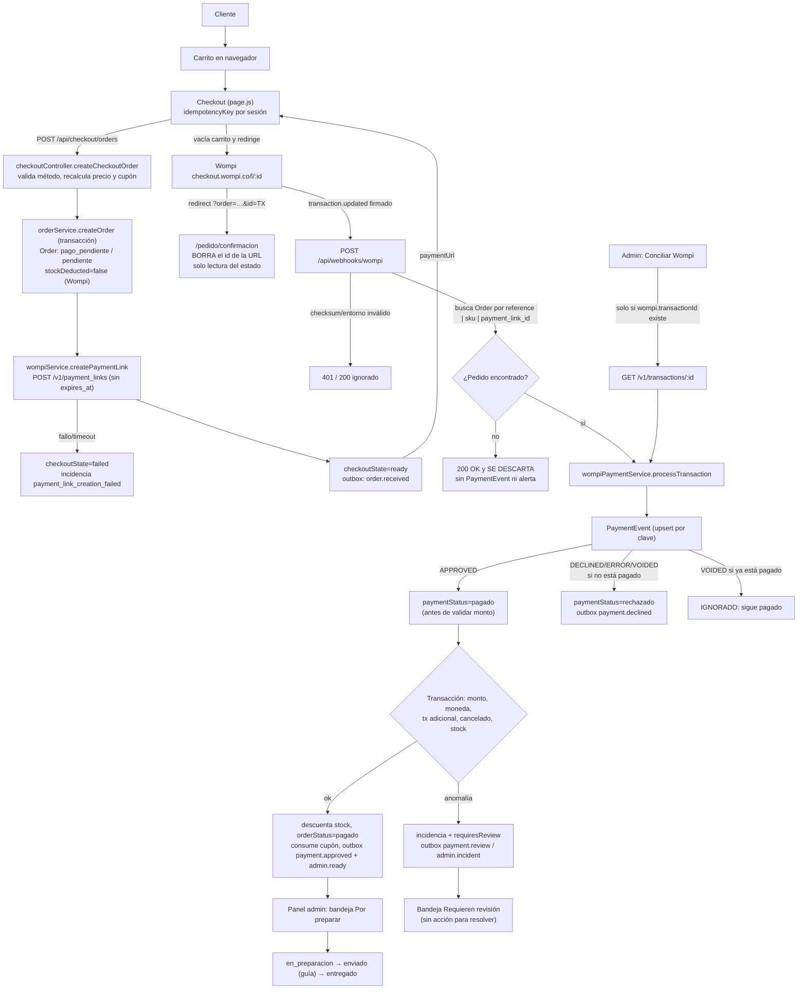

# 02 · Arquitectura y flujos reales — Wompi y pedidos DIZOR

Auditoría independiente · 2026-11-23 · Código inspeccionado: commit `9289c7b` (rama `main`, árbol limpio). **Lo descrito es el código local, no lo desplegado**: producción sigue corriendo una versión anterior (ver 08 §4).

## 1. Modalidad de integración Wompi

**Links de pago (Payment Links API), no Widget ni Web Checkout.**

| Elemento | Evidencia |
|---|---|
| Creación del enlace `POST /v1/payment_links` con llave privada | `backend/src/services/wompiService.js:13-63` |
| Cuerpo enviado: `single_use: true`, `currency: "COP"`, `amount_in_cents = Math.round(order.total*100)`, `sku = orderNumber`, `redirect_url = CLIENT_URL/pedido/confirmacion?order=…&payment=wompi`. **No envía `expires_at`** | `wompiService.js:20-31` |
| URL entregada al cliente `https://checkout.wompi.co/l/<id>` | `wompiService.js:58-62` |
| No existe firma de integridad (`signature:integrity`) porque no se usa Widget/Web Checkout; el monto lo fija el enlace en el proveedor | búsqueda en `backend/src` y `frontend/src`: sin `integrity` |
| Consulta de transacción `GET /v1/transactions/{id}` con llave privada | `wompiService.js:128-137` |
| Consulta pública de enlace `GET /v1/payment_links/{id}` (solo para decidir si se incluye un enlace de reintento en el correo de rechazo) | `wompiService.js:139-145`, `notificationDelivery.js:49-62` |

Consecuencia clave contrastada con la documentación oficial: en los Links de pago **la referencia de cada transacción la genera Wompi** (docs “seguimiento de transacciones”), y el contrato de eventos **no incluye `sku`** (docs “eventos”, ejemplo de `data.transaction`). El único vínculo fiable entre una transacción y el pedido es `payment_link_id`, cuyo poblado en transacciones de enlaces **no está garantizado en la documentación** (ejemplos con `null`). Ver hallazgo WP-01.

## 2. Componentes y archivos

| Capa | Archivo | Responsabilidad |
|---|---|---|
| Frontend checkout | `frontend/src/app/(shop)/checkout/page.js` | Clave de idempotencia por sesión de página (`:59-63`), bloqueo de doble envío (`:284-285`), `POST /api/checkout/orders`, guarda token de acceso, **vacía el carrito (`:314`) y redirige a Wompi (`:321`)** |
| Frontend confirmación | `frontend/src/app/(shop)/pedido/confirmacion/page.js` | Consulta `POST /api/checkout/orders/lookup`; **elimina de la URL cualquier parámetro distinto de `order` (`:528-531`), incluido el `id` de transacción que añade Wompi**; sin sondeo periódico |
| Rutas checkout | `backend/src/routes/checkoutRoutes.js` | `/config`, `/calculate`, `/orders`, `/track`, `/orders/lookup`, `/orders/:id`, `/orders/:id/cancel` |
| Controlador checkout | `backend/src/controllers/checkoutController.js` | Validación, recálculo, cupón, idempotencia, creación de pedido, creación de enlace, autocancelación |
| Precio y totales | `backend/src/services/cartService.js:8-103` | Precio desde BD, stock por línea, totales; envío 0 si está incluido (`settingsService.js:11-13,43-44`) |
| Creación de pedido | `backend/src/services/orderService.js:22-135` | Transacción Mongo; descuenta stock **solo si no es Wompi** |
| Webhook | `backend/src/routes/wompiWebhookRoutes.js`, `controllers/wompiWebhookController.js` | `POST /api/webhooks/wompi`: checksum, entorno, asociación al pedido |
| Aplicación del pago | `backend/src/services/wompiPaymentService.js` | Bandeja durable `PaymentEvent`, `pagado`, validaciones, stock, cupón, incidencias |
| Firma | `backend/src/services/wompiService.js:65-119` | SHA-256 de `signature.properties` + `timestamp` + secreto de eventos; ventana 26 h; comparación en tiempo constante |
| Estados y permisos | `services/orderTransitions.js`, `services/orderReadiness.js`, `services/orderOperations.js` | Máquina de estados, requisito de pago para preparar, incidencias |
| Administración | `controllers/orderAdminController.js`, `routes/adminOrderRoutes.js`, `services/orderWorkspace.js` | Bandejas, transición, recaudo contraentrega, **conciliación Wompi solo con `transactionId` ya guardado (`:194-205`)** |
| Notificaciones | `services/notificationEvents.js`, `services/notificationDelivery.js` | Outbox transaccional; envío solo si `TRANSACTIONAL_NOTIFICATIONS_ENABLED=true` (`server.js:36-38`) |
| Finanzas | `services/financeCriteria.js` | Venta conciliada = `pagado`, no cerrado, sin revisión ni incidencia activa |
| Métodos de pago | `services/paymentMethods.js` | Solo `wompi` (si hay llave privada y secreto de eventos) y `contra_entrega`; Nequi propio desactivado |

Modelos: `Order` (`models/order.js`), `PaymentEvent` (`models/paymentEvent.js`, índice único `key`), `Product` (stock por variante), `ProductHistory` (movimientos), `Coupon`, `Notification`. **No existe** entidad “intento de pago”: el pedido guarda un solo `wompi.transactionId` (el último recibido); el historial de transacciones vive en `PaymentEvent` y en notas de `statusHistory`.

## 3. Diagrama del flujo real

Diferencias entre el flujo esperado y el encontrado (marcadas en el diagrama): (1) evento no asociado descartado en silencio; (2) el `id` de redirección se pierde; (3) `pagado` se escribe antes de validar; (4) `VOIDED` tras `APPROVED` se ignora; (5) la bandeja de revisión no tiene acción de cierre.

## 4. Ciclo completo del pedido

1. **Clic en “Confirmar”**: el frontend envía ítems (`productId`, `variantId`, `quantity`), comprador, dirección, método, transportadora, notas, cupón, `idempotencyKey`, consentimientos.
2. **Servidor** (`checkoutController.js:198-491`): datos obligatorios; consentimiento; método habilitado (`:230-237`); transportadora; términos; formato de clave; huella `sha256` de la solicitud (`:271-274`); repetición de clave → devuelve el mismo pedido si la huella coincide y está `ready`, si no 409 (`:275-290`); recalcula precios desde BD (`cartService.js:43-51`); cupón validado pero no consumido (`:296-329`).
3. **Persistencia** (`orderService.js:60-117`): pedido Wompi con `orderStatus=pago_pendiente`, `paymentStatus=pendiente`, `stockDeducted=false`, `checkoutState=processing`. Contraentrega: descuenta stock y consume cupón en la misma transacción.
4. **Enlace Wompi**: se crea fuera de la transacción; si falla, el pedido queda `failed` con incidencia.
5. **`ready`**: tras registrar consentimientos pasa a `checkoutState=ready` y encola `order.received`. **Desde la creación (paso 3) el pedido es visible en el administrador** (bandeja “Todos”; si queda `processing/failed`, en “Requieren revisión”). Un pedido Wompi no pagado **no** aparece en “Por preparar” (filtro `orderReadiness.js:2-8`).
6. **Pago en Wompi** → evento `transaction.updated` → `processTransaction`.
7. **Aprobado y coherente** → `pagado`, stock −1, aviso “listo para preparar”. Preparar/enviar exige `paymentStatus=pagado` y `canFulfill` (`orderTransitions.js:22-27`).
8. **Despacho**: `en_preparacion` → `enviado` (requiere transportadora y guía) → `entregado`.

Contraentrega: `pendiente` → preparar → enviar → entregar → recaudo registrado por admin con referencia y fecha (`orderTransitions.js:42-50`, `orderAdminController.js:61-80`).

## 5. Relación Wompi ↔ backend ↔ BD ↔ administrador

| Dato | Dónde | Quién lo escribe |
|---|---|---|
| `wompi.paymentLinkId/Url` | Order | checkout al crear enlace |
| `wompi.transactionId/status/reference` | Order | webhook o conciliación (sobrescribe con la última transacción no aprobada o con la primera aprobada) |
| Evidencia por evento (id, estado, monto, moneda, entorno, checksum, timestamp, `processedAt`, `lastError`) | PaymentEvent | webhook / conciliación / autocancelación |
| Incidencias (`code`, `detail`, `resolvedAt`) | Order.incidents | servicio de pagos y transiciones; **ningún endpoint las resuelve** |
| Movimientos de stock | ProductHistory | `inventoryService.moveStock` (siempre en transacción) |
| Avisos | Notification (outbox) | dentro de las mismas transacciones |

El administrador ve en el detalle: método, `paymentStatus`, `wompi.*`, incidencias con etiqueta (`orderWorkspace.js:29-36`), acción principal (`:37-59`) y botón de conciliación solo si hay `transactionId` (`:41`).

## 6. Dependencias técnicas y puntos de fallo

- **MongoDB con replica set obligatorio**: `transactionService.inTransaction` usa transacciones multi-documento sin alternativa (`transactionService.js:3-12`). En un standalone, crear pedidos contraentrega y aplicar pagos fallaría. Atlas cumple; destino no verificado.
- **Wompi API** (crear enlace, consultar transacción): timeout 10 s; sin reintento automático.
- **Entrega del webhook**: única vía de confirmación automática. Wompi reintenta máximo 3 veces en 24 h ante no-200 (docs eventos).
- **Resend** para correos, solo con banderas activadas.
- **Limitadores de tasa** aplicados también al webhook (`app.js:105`, `rateLimitMiddleware.js:49-58`).
